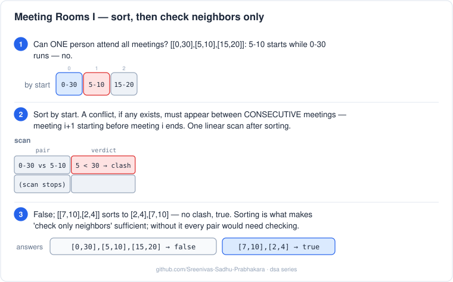

# Meeting Rooms

> NeetCode 150 · Intervals · Blind 75 — sort by start; any conflict must then be between neighbors, so one adjacent-pair scan decides. Go, stdlib only, tested.

## Problem

Can a single person attend every meeting — i.e., do no two intervals overlap? (Back-to-back meetings, one ending as the next starts, are fine.)

## Approach

Unsorted, overlap could hide between any pair — O(n²) checks. Sorted by start time, an overlap can only occur between *adjacent* meetings: if meeting i overlaps some later j, it also overlaps i+1, because starts are non-decreasing. So sort and scan neighbors for `next.start < prev.end`. That sorted-adjacency argument is the foundation the heavier interval problems (merge dsa-008, rooms-needed dsa-242) stand on; this problem is its minimal exercise.

**Complexity:** O(n log n) time, O(n) copy.

## Visual walkthrough

Read the picture top to bottom — each numbered frame is one moment of the algorithm
running on this repo's test example.

## Run

    go test ./...   # verify
    go run .        # demo

---

Part of a 275-repo DSA series in Go — Striver's SDE Sheet (dsa-001–191) plus the NeetCode 150 / Blind 75 additions (dsa-192–275), stdlib only, every solution tested. Browse: [`dsa-*` repos](https://github.com/Sreenivas-Sadhu-Prabhakara?tab=repositories&q=dsa-&type=source).
